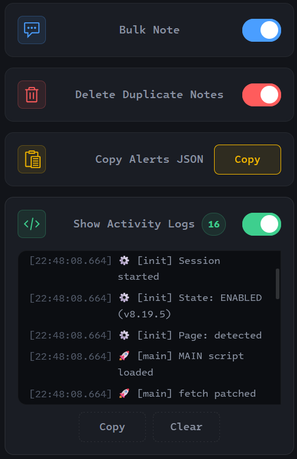

# Kibana Note Extention

<div align="center">
  
</div>

<p align="center">
    <a href="https://github.com/mehrazino/kibana-extention/blob/master/LICENSE" alt="License">
        </a>
    <a href="https://developer.mozilla.org/en-US/docs/Web/JavaScript" alt="JavaScript">
        </a>
    <a href="https://developer.mozilla.org/en-US/docs/Web/HTML" alt="HTML5">
        </a>
    <a href="https://developer.mozilla.org/en-US/docs/Web/CSS" alt="CSS3">
        </a>
    <a href="https://www.google.com/chrome/" alt="Chromium Supported">
        </a>
    <a href="https://www.mozilla.org/firefox/" alt="Firefox Supported">
        </a>
</p>

---

A lightweight, cross-browser extension designed to streamline the workflow of security analysts and Kibana users. It eliminates the repetitive task of manually applying notes to multiple alerts by intercepting Kibana's network requests and seamlessly "fanning out" the action across all selected alerts.

> **Disclaimer:** This extension is not affiliated with, endorsed by, or supported by Elastic. It relies on Kibana's internal APIs and DOM structure.

## ✨ Overview

When investigating security alerts in Kibana, analysts often need to tag, annotate, or close multiple related alerts with the exact same note. Kibana's native UI requires you to add notes one alert at a time. 

**Kibana Bulk Note** solves this by hooking into Kibana's internal APIs. Once you add a note to a single alert within a multi-selected view, the extension automatically replicates that exact note to every other selected alert. It also includes tools for cleaning up duplicate notes and exporting selected alerts as JSON.

## 📸 Screenshot

<p align="center">
  
</p>

## 🚀 Features

- **📝 Bulk Note Fan-out:** Select multiple alerts, open one of them, and add a note. The extension intercepts the save request and mirrors the note to all other selected alerts.
- **🗑️ Duplicate Note Cleanup:** Delete a specific note from one alert, and the extension will automatically find and delete identical notes across all other selected alerts.
- **📋 Copy Alerts JSON:** Instantly fetch and copy the full JSON payload of all currently selected alerts to your clipboard.
- **📊 Activity Logs:** A built-in, real-time logging panel in the popup to monitor exactly what the extension is doing (successes, failures, and API interactions).
- **🌐 Cross-Browser Support:** Fully compatible with both Chromium-based browsers and Gecko-based browsers.

## ⚙️ How It Works

The extension uses a dual-script architecture to ensure stability and security:
1. **Isolated Script (`content.js`):** Handles state management, the popup UI communication, logging, and browser storage persistence.
2. **Main Script (`page-script.js`):** Runs in the page's context and safely patches the `window.fetch` API to intercept Kibana's network requests.

### The Fetch Interception Workflow
1. When you add a note, Kibana sends a `PATCH` request to its internal notes API.
2. The extension intercepts this request, extracts the source alert ID, and the note text.
3. It then determines the IDs of all other selected alerts. To do this reliably across different Kibana versions, the extension triggers Kibana's native bulk action mechanism. **This is why the selected alerts open when you perform an action:** it forces Kibana to generate the exact list of targeted document IDs in the network payload, which the extension then intercepts.
4. Finally, it issues concurrent `PATCH` requests for every target alert, seamlessly mirroring the note without triggering unnecessary UI refreshes.

## 📦 Installation

Since this is a self-hosted extension, you need to load it manually into your browser.

### For Chromium-based Browsers (Google Chrome, Microsoft Edge, Brave)
1. Download or clone this repository to your local machine.
2. Open your browser and navigate to `chrome://extensions/`.
3. Enable **Developer mode** (toggle in the top right corner).
4. Click **Load unpacked** and select the folder containing this project.

### For Gecko-based Browsers (Mozilla Firefox, LibreWolf, Tor Browser)
1. Download or clone this repository to your local machine.
2. Open Firefox and navigate to `about:debugging#/runtime/this-firefox`.
3. Click **Load Temporary Add-on...**.
4. Select the `manifest.json` file from the project folder.
*(Note: Temporary add-ons in Firefox are removed when the browser closes. We are currently pursuing the signing of this add-on for Gecko-based browsers to ensure it can be installed permanently.).*

## 🛠️ Usage

### 1. Bulk Note
1. Open Kibana and navigate to the **Security -> Alerts** page.
2. Open the extension popup and ensure **Bulk Note** is toggled **ON**
3. Select multiple alerts using the checkboxes on the left side of the DataGrid.
4. Open the flyout for **one** of the selected alerts.
5. Add your note to the notes section and save it.
6. Check the **Activity Logs** in the popup to see the note being applied to the other alerts in real-time.

### 2. Delete Duplicate Notes
1. Toggle **Delete Duplicate Notes** to **ON** in the extension popup.
2. With multiple alerts selected, open the flyout of the alert containing the note you want to remove.
3. Click the delete icon next to the note.
4. The extension will scan the other selected alerts, find notes with the exact same text, and delete them.

### 3. Copy Alerts JSON
1. Select the alerts you want to export.
2. Open the extension popup and click **Copy** next to "Copy Alerts JSON".
3. The JSON data for all selected alerts is now in your clipboard, ready to be pasted into your analysis tools.

## 📂 Project Structure

The extension is built with a modular, dual-context architecture:

```text
kibana-bulk-note-extension-v1/
│
├── intel-one-mono-woff2/       # Custom fonts for the UI
│   ├── IntelOneMono-Bold.woff2
│   ├── IntelOneMono-BoldItalic.woff2
│   ├── IntelOneMono-Italic.woff2
│   ├── IntelOneMono-Light.woff2
│   ├── IntelOneMono-LightItalic.woff2
│   ├── IntelOneMono-Medium.woff2
│   ├── IntelOneMono-MediumItalic.woff2
│   └── IntelOneMono-Regular.woff2
│
├── background.js               # Background service worker (handles icon states)
├── content.js                  # Isolated world script (UI bridge & storage)
├── page-script.js              # Main world script (fetch interception & API logic)
│
├── popup.html                  # Extension popup interface (HTML5)
├── popup.css                   # Popup UI styles (CSS3)
├── popup.js                    # Popup logic & activity log rendering (JavaScript)
│
├── manifest.json               # Extension configuration (Manifest V3)
├── elastic-kibana-color.png    # Active extension icon
├── elastic-kibana-gray.png     # Inactive extension icon
│
├── README.md                   # Project documentation and guide
├── LICENSE                     # Project license (GPL-3.0)
└── screenshot1.png             # Extension preview image
```

## 🗺️ Roadmap

- [ ] **Future Kibana Support:** Continuously update the extension to support newer Kibana versions and adapt to API changes.
- [ ] **API Key Integration:** Investigate the possibility of adding Kibana API Key support for users who prefer explicit authentication over browser sessions.
- [ ] **UI Bypass:** Eliminate the need to forcefully open selected alerts (flyout) to resolve their IDs, making the workflow completely seamless.
- [ ] **Success Notifications:** Add visual notifications (toasts) to confirm when a bulk action is successfully completed.
- [ ] **Store Publishing:** Publish the extension to the Chrome Web Store and Mozilla Add-ons for easier installation.

## 🤝 Contributing & Issues

We welcome contributions from the community! If you have an idea to improve the extension or want to add a new feature, feel free to fork the repository and submit a pull request. 

If you encounter any bugs, unexpected behavior, or have a question, please **open an issue** on GitHub. Your feedback helps make this tool better for everyone. Let's build and improve it together!

👉 **[Open an Issue](https://github.com/mehrazino/kibana-extention/issues)**  
👉 **[Submit a Pull Request](https://github.com/mehrazino/kibana-extention/pulls)**

## 📄 License

This project is licensed under the **GPL-3.0 License**. See the [LICENSE](https://github.com/mehrazino/kibana-extention/blob/master/LICENSE) file for more details.
